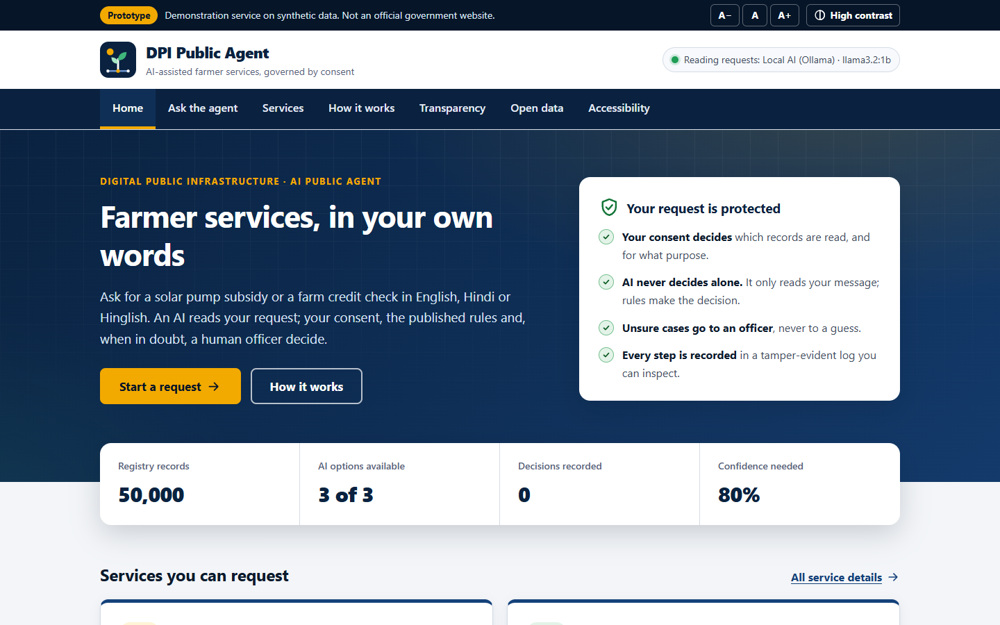
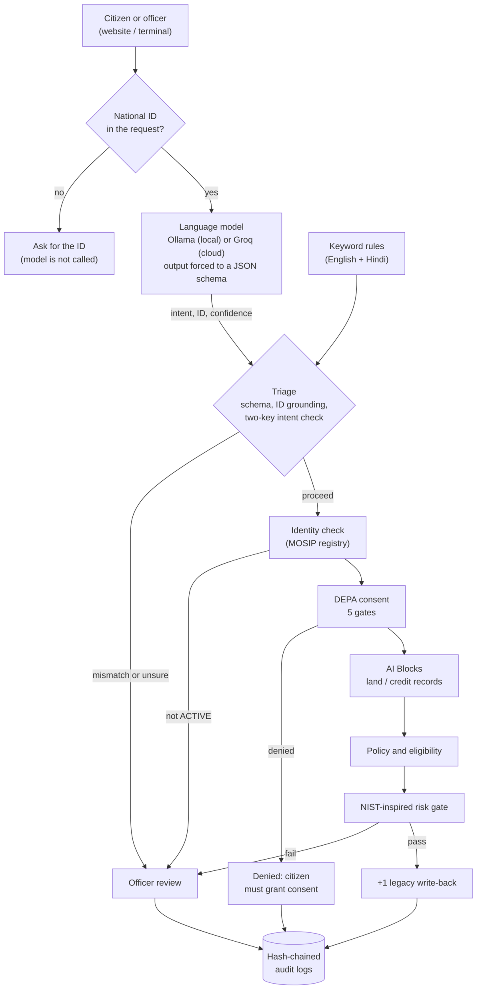
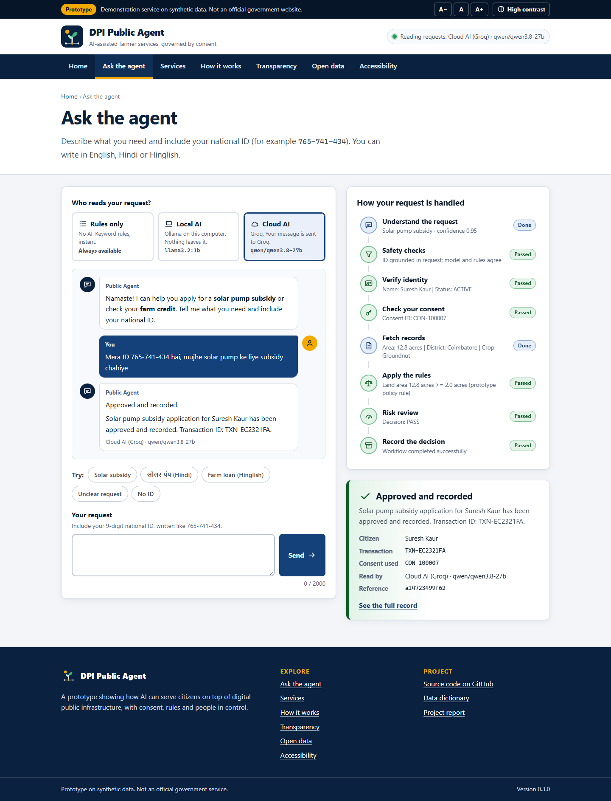
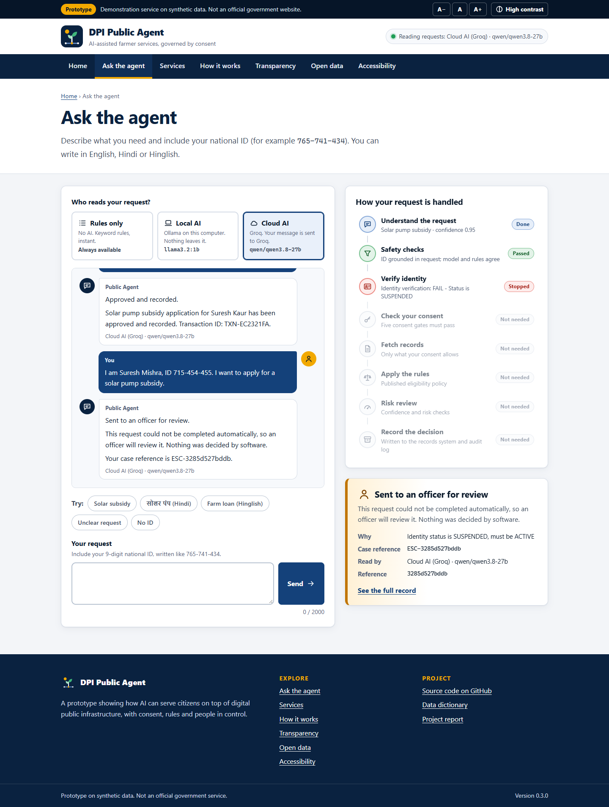
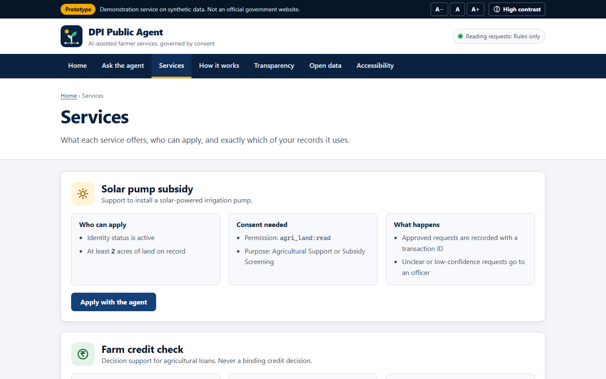
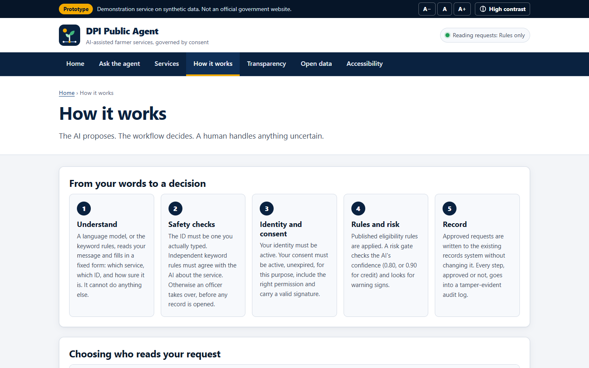
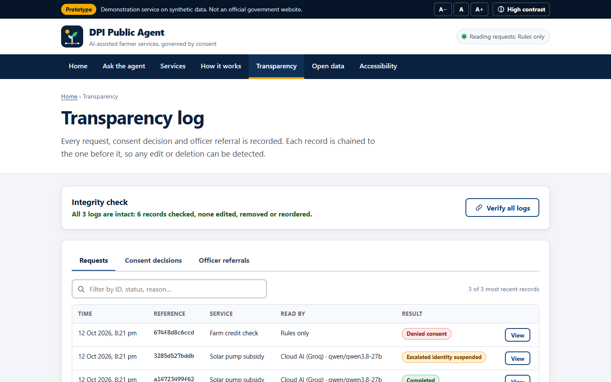
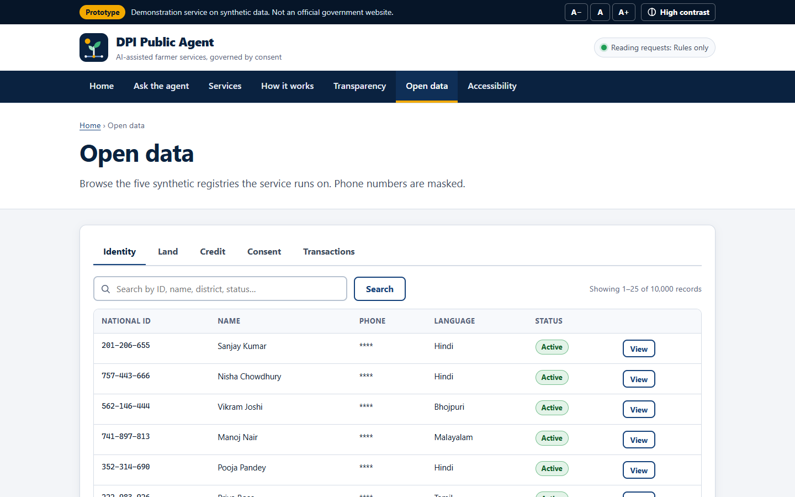
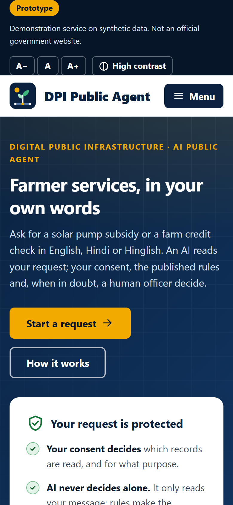
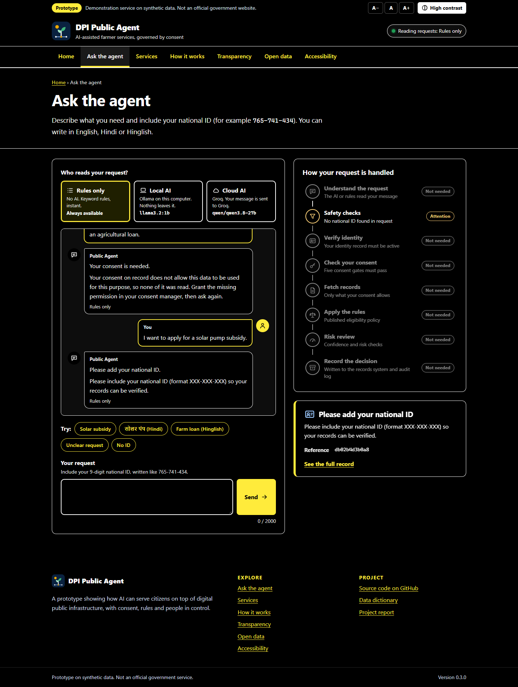

# Sovereign DPI-AI Public Agent

[](https://github.com/t20071/ai_dpi_cdpi/actions/workflows/ci.yml)

An AI **public agent** built on Digital Public Infrastructure (DPI). A farmer or extension
officer types a request in plain language, for example *"Mera ID 765-741-434 hai, mujhe solar
pump ke liye subsidy chahiye"*. A **language model** works out what they want. It can be a
local model in **Ollama**, a cloud model through the **Groq API**, or no model at all. A
**deterministic workflow** then decides whether the request is allowed. It checks identity,
DEPA-style consent, eligibility policy and a NIST AI RMF-inspired risk gate, sends uncertain
cases to a human officer, and writes every decision to a tamper-evident audit log.

It runs on your own computer, and it can be deployed as a public website on Vercel's free plan.

> [!WARNING]
> This is a **prototype**, not a production government system or an official government
> website. All data is synthetic. It does not implement real government APIs, legal compliance
> frameworks or production security hardening.



## Contents

- [How it works](#how-it-works)
- [Screenshots](#screenshots)
- [Run it locally](#run-it-locally)
- [Choosing the AI: rules, local Ollama or Groq cloud](#choosing-the-ai-rules-local-ollama-or-groq-cloud)
- [Tweaking the model (LLM or SLM)](#tweaking-the-model-llm-or-slm)
- [Deploy to Vercel (free plan)](#deploy-to-vercel-free-plan)
- [Command reference](#command-reference)
- [Configuration](#configuration)
- [Evaluating models](#evaluating-models)
- [Project structure](#project-structure)
- [Tests and code quality](#tests-and-code-quality)
- [Governance and security controls](#governance-and-security-controls)
- [Demo scenarios](#demo-scenarios)
- [Troubleshooting](#troubleshooting)
- [Known limitations](#known-limitations)

---

## How it works

**The model proposes. The workflow decides.** The language model only *interprets* a request.
It never reads citizen records, chooses tools or makes decisions.



### Why it is built this way

| Decision | Why |
|----------|-----|
| **The model only interprets** | Models make mistakes. The model fills in `intent`, `national_id`, `language` and `confidence`; the workflow, not the model, fixes which tools run for each intent. |
| **Schema-constrained output** | Ollama's `format` and Groq's strict structured outputs force the reply to match a JSON schema, so even a 1B-parameter model returns valid fields and allowed intent values. |
| **Few-shot prompt** | Three worked examples (English, Hindi, off-topic) in the prompt. On `llama3.2:1b` it classifies a Hinglish loan request correctly that an earlier, simpler zero-shot prompt labelled a subsidy request. |
| **ID grounding** | The workflow only acts on a national ID the citizen typed. A hallucinated ID, or a request naming two IDs, goes to an officer. A request with no ID is asked for one and never reaches the model. |
| **Two-key intent check** | Independent keyword rules must agree with the model's intent before any data is read. Disagreement or no supporting evidence goes to an officer. This also blocks prompt injection: if the model obeys an injected "say intent=credit", the rules disagree and nothing runs. |
| **Triage before data access** | All of the above runs before identity, land or credit records are touched (data minimisation). |
| **Graceful degradation** | If Ollama or Groq is down, rate-limited or misconfigured, the keyword rules take over and the fallback is recorded in the trace and audit log. |
| **Evals with a safety metric** | `dpi-agent eval` scores each model on 30 labelled requests and counts **unsafe actions** (workflows that should not have started). The target is 0. |
| **Tamper-evident audit** | Each audit record stores the hash of the previous one. `dpi-agent audit verify` (or the website's *Verify all logs* button) detects edited or deleted records. |

---

## Screenshots

The website is built to look and work like a public-service portal. It has a skip link, text
size controls, a high-contrast mode, full keyboard support and screen-reader announcements.
It loads no third-party scripts, fonts or trackers.

| | |
|---|---|
|  **Ask the agent.** A Hinglish request read by Groq, every step shown, then approved. |  **Officer review.** A suspended identity stops the workflow; later steps are skipped. |
|  **Services.** Who can apply and exactly which consented data is used. |  **How it works.** The pipeline, AI options and consent gates in plain language. |
|  **Transparency.** Every decision recorded; *Verify all logs* checks the hash chain. |  **Open data.** Browse the five synthetic registries (phones masked). |
|  **Mobile.** Responsive down to phone width. |  **High contrast.** One click, remembered between visits. |

Regenerate them after UI changes with `python scripts/take_screenshots.py` (see
[Tests and code quality](#tests-and-code-quality)).

---

## Run it locally

Commands are shown for **Windows PowerShell**; macOS/Linux differences are noted.

### 1. Prerequisites

- **Python 3.11 or newer**. Check with `python --version`.
- **Git**.
- Optional: **Ollama** (<https://ollama.com/download>) for a local model, and/or a free **Groq
  API key** (<https://console.groq.com/keys>) for a cloud model. Without either, everything
  runs on the keyword rules.

### 2. Get the code

```powershell
git clone https://github.com/t20071/ai_dpi_cdpi.git
cd ai_dpi_cdpi
```

### 3. Create a virtual environment and install

```powershell
python -m venv .venv
.venv\Scripts\Activate.ps1          # macOS/Linux: source .venv/bin/activate
pip install -e ".[dev]"
```

This installs the `dpi-agent` command. The app itself needs **no third-party packages**;
`[dev]` adds pytest and ruff.

> If PowerShell refuses to run `Activate.ps1`, run
> `Set-ExecutionPolicy -Scope CurrentUser RemoteSigned` once, or skip activation and call
> `.venv\Scripts\dpi-agent` directly.

### 4. Add your settings (`.env`)

```powershell
copy .env.example .env              # macOS/Linux: cp .env.example .env
```

Open `.env` and set what you need, for example your Groq key:

```ini
LLM_PROVIDER=ollama          # default for new requests: ollama | groq | deterministic
GROQ_API_KEY=gsk_...         # from https://console.groq.com/keys
```

`.env` is listed in `.gitignore` and `.vercelignore`, so the key is never committed or uploaded.

### 5. Run it

```powershell
dpi-agent serve        # website at http://127.0.0.1:8000
dpi-agent              # interactive terminal menu
dpi-agent ask "I am Suresh Kaur, ID 765-741-434. I want to apply for a solar pump subsidy."
dpi-agent scenario all # the three demo scenarios
```

On first run the five CSV registries in `data/raw/` are imported into
`data/runtime/simulated_dpi.db` (about a second).

---

## Choosing the AI: rules, local Ollama or Groq cloud

Three interpreters can read a request. All three feed the same safety checks and workflow.

| Option | Where it runs | What is sent outside the app | Setup |
|--------|---------------|-------------------------------|-------|
| **Rules only** (`deterministic`) | In the app | Nothing | None |
| **Local AI** (`ollama`) | Your computer | Nothing | Install Ollama, `ollama pull llama3.2:3b` |
| **Cloud AI** (`groq`) | Groq's servers | The citizen's message only, never their records | `GROQ_API_KEY` in `.env` |

- **On the website**, every visitor picks under *Who reads your request?*. Options that are not
  available (Ollama not running, no Groq key) are greyed out with the reason.
- **In the terminal**, use `--provider` and `--model` on any command, or set `LLM_PROVIDER`:

```powershell
dpi-agent models                                   # local and cloud models you can use
dpi-agent ask --provider groq "Mera ID 213-163-577 hai, mujhe kheti ke liye loan chahiye"
dpi-agent ask --provider ollama --model llama3.2:1b "ID 765-741-434, solar pump subsidy"
dpi-agent serve --provider groq                    # make Groq the website's default
```

`OLLAMA_MODEL=auto` (the default) uses the largest chat model installed in Ollama.
`GROQ_MODEL` defaults to `qwen/qwen3.8-27b`, which scored best in the [evals](#evaluating-models).

> [!NOTE]
> Choosing **Cloud AI** sends the request text to Groq, so it is no longer "sovereign" (all
> on your hardware). The registries, consent records and decisions never leave the app.
> Use **Local AI** when data must stay on your own machine.

---

## Tweaking the model (LLM or SLM)

The safety layer does not trust the model, so you can swap in a **small language model (SLM)**
and measure the effect safely. Start with the cheapest change that works:

1. **Pick a different model.** No code change needed:
   - Local SLMs in Ollama, for example `ollama pull llama3.2:3b`, `ollama pull qwen2.5:3b`,
     `ollama pull gemma2:2b` or `ollama pull phi4-mini`, then `OLLAMA_MODEL=qwen2.5:3b`.
   - Groq models, set with `GROQ_MODEL`. `openai/gpt-oss-20b` is smaller and faster;
     `qwen/qwen3.8-27b` and `openai/gpt-oss-120b` are more accurate. Run `dpi-agent models` to
     see what your key can use today.
2. **Measure it.** `dpi-agent eval --provider ollama --all-models`, or
   `dpi-agent eval --provider groq --model openai/gpt-oss-20b --model qwen/qwen3.8-27b`.
   Compare intent accuracy, unsafe actions and over-held cases (see below).
3. **Tune the prompt**, in [`src/dpi_agent/llm/prompts.py`](src/dpi_agent/llm/prompts.py):
   - the system prompt that describes each intent;
   - the few-shot examples (add one in a language your users write in);
   - `PLAN_SCHEMA`, the fields the model must return.

   Small models gain the most from clearer intent descriptions and more examples. Re-run the
   eval after every change.
4. **Widen the second key.** [`llm/rules.py`](src/dpi_agent/llm/rules.py) holds the keyword
   rules that must agree with the model. Adding words (for example Tamil or Marathi terms) lets
   more correct model answers proceed instead of going to an officer.
5. **Bake settings into a custom Ollama model.** No retraining involved:

   ```text
   # Modelfile
   FROM llama3.2:3b
   PARAMETER temperature 0
   PARAMETER num_ctx 4096
   ```

   ```powershell
   ollama create dpi-intake -f Modelfile
   dpi-agent eval --provider ollama --model dpi-intake
   ```

6. **Fine-tune** (not included). For a specialised SLM, collect labelled requests in the
   `evals/intent_cases.jsonl` format and train a LoRA adapter with your preferred tool. Load it
   in Ollama with an `ADAPTER` line in the Modelfile, then evaluate it the same way. Keep a
   held-out set: never evaluate on the requests you trained on.

Thresholds (`CONFIDENCE_THRESHOLD`, `HIGH_IMPACT_CONFIDENCE_THRESHOLD`) are in `.env`. Models
report their own confidence, which is a weak signal, so the two-key check matters more.

---

## Deploy to Vercel (free plan)

The project deploys as-is to Vercel's free **Hobby** plan:

- The website in `public/` is served from Vercel's CDN.
- [`api/index.py`](api/index.py) runs the Python backend as a serverless function.
- Groq does the AI, because Ollama cannot run inside Vercel.

```text
Browser ──> Vercel CDN ── public/  (index.html, assets/)
        └─> /api/*  ──rewrite──> api/index.py  (WSGI app) ──> src/dpi_agent
                                         │
                                         └──> Groq API (GROQ_API_KEY)
```

### What to push, and from which folder

Push the **whole repository**, from the folder that contains `vercel.json` (the repository
root, `ai_dpi_cdpi/`). On Vercel the **Root Directory** stays `./`. Do not point Vercel at
`src/` or `public/`; `vercel.json` already tells Vercel where everything is.

### Steps (Git + Vercel dashboard)

1. **Push to GitHub.** From the repository root:

   ```powershell
   git status                 # .env must NOT appear in the list
   git add -A
   git commit -m "Restructure, Groq provider, new website, Vercel deployment"
   git push origin main
   ```

2. **Import the project.** Sign in at <https://vercel.com> (the Hobby plan is free for personal,
   non-commercial projects). Choose *Add New… → Project*, then pick the `ai_dpi_cdpi` GitHub
   repository and *Import*.
3. **Leave the build settings alone.** `vercel.json` sets everything:
   - **Root Directory**: `./`
   - **Framework Preset**: *Other*
   - **Build/Output settings**: no build command; output directory `public`
4. **Add environment variables** under *Environment Variables*, before the first deploy:

   | Name | Value | Needed? |
   |------|-------|---------|
   | `GROQ_API_KEY` | your key from <https://console.groq.com/keys> | **Yes**, for Cloud AI |
   | `GROQ_MODEL` | e.g. `qwen/qwen3.8-27b` | Optional (that is the default) |
   | `REFERENCE_TIME` | `2026-10-01T00:00:00+00:00` | Recommended: keeps demo outcomes stable as consent dates pass |
   | `RATE_LIMIT_PER_MINUTE` | e.g. `10` | Optional: AI requests per visitor per minute |

5. **Deploy.** After a minute you get `https://<your-project>.vercel.app`. Check
   `https://<your-project>.vercel.app/api/health`: `"deployment": "vercel"` and
   `"groq": {"available": true, ...}` mean everything is wired up.

Every later `git push` redeploys automatically. **Changing an environment variable needs a
redeploy** (*Deployments → ⋯ → Redeploy*).

### Alternative: Vercel CLI

```powershell
npm install -g vercel
vercel                        # first run: log in, link the project, deploy a preview
vercel env add GROQ_API_KEY   # paste the key when asked; choose Production (and Preview)
vercel --prod                 # deploy to production
```

`.vercelignore` stops the CLI from uploading `.env`, `.venv/` and other local files.

### What is different in the cloud

| | Local (`dpi-agent serve`) | Vercel |
|---|---|---|
| AI options | Rules, Ollama, Groq | Rules, Groq (Ollama is shown as unavailable) |
| Database | `data/runtime/simulated_dpi.db`, kept | Rebuilt in `/tmp` from `data/raw/` on each cold start (~1–2 s) |
| Audit logs | Kept in `data/runtime/audit/` | Temporary: reset when the function instance restarts |
| Host check | Loopback names only (blocks DNS rebinding) | Any host (`ALLOWED_HOSTS=*`) |

### Free-tier limits to know

- **Groq**: on the author's free key the models allowed about **8,000 tokens per minute** and
  1,000 requests per day (check your own limits in the Groq console). One request uses about
  700–800 tokens, so roughly 10 AI requests per minute across all visitors.
  - Short rate-limit waits are retried automatically.
  - Longer ones fall back to the keyword rules, and the website says so.
- **Your quota is public**: anyone with the URL can use your Groq quota through the site.
  - The site limits each visitor to `RATE_LIMIT_PER_MINUTE` AI requests and never shows the key.
  - For a private demo, turn on *Deployment Protection* in the Vercel project settings.

---

## Command reference

| Command | What it does |
|---------|--------------|
| `dpi-agent` | Interactive menu: scenarios, chat, audit logs, models, audit verification |
| `dpi-agent serve [--port 8000] [--provider P] [--model M]` | Website and REST API on `127.0.0.1` |
| `dpi-agent ask "TEXT" [--json] [--provider P] [--model M] [--offline]` | Run one request and print each step |
| `dpi-agent scenario a\|b\|c\|all` | Run a demo scenario (always with the rules) |
| `dpi-agent models` | List local (Ollama) and cloud (Groq) models, and which are in use |
| `dpi-agent eval [--provider P] [--model M ...] [--all-models] [--offline] [--verbose-cases]` | Score models on `evals/intent_cases.jsonl` |
| `dpi-agent audit verify` | Check every audit log's hash chain |
| `dpi-agent audit show consent\|workflow\|escalations [--limit N]` | Print recent audit records |
| `dpi-agent init-db [--rebuild]` | Import the CSVs into SQLite (`--rebuild` re-imports) |

`P` is `ollama`, `groq` or `deterministic`; `--offline` means `deterministic`.
`python -m dpi_agent ...` works the same as `dpi-agent ...`. Add `-v` (or `-vv`) for logs.

### REST API (used by the website)

| Method and path | Purpose |
|-----------------|---------|
| `GET /api/health` | Each AI option's availability and model, database and policy status |
| `POST /api/chat` with `{"query": "...", "provider": "groq"}` | Run a request (`provider` is optional) |
| `POST /api/scenario/{a,b,c}` | Run a demo scenario |
| `GET /api/audit/{consent,workflow,escalations}?limit=N` | Read an audit log |
| `GET /api/audit/verify` | Check every audit log's hash chain |
| `GET /api/registries/{identity,agriculture,credit,consent,legacy}?q=&limit=&offset=` | Browse registry data |

POST requests must use `Content-Type: application/json`.

---

## Configuration

All settings live in `.env` (copied from [`.env.example`](.env.example)) locally, or in
*Environment Variables* on Vercel. Real environment variables override `.env`.

| Setting | Default | Meaning |
|---------|---------|---------|
| `LLM_PROVIDER` | `ollama` (`groq` on Vercel) | Default interpreter: `ollama`, `groq` or `deterministic` |
| `OLLAMA_HOST` | `http://localhost:11434` | Where Ollama is listening |
| `OLLAMA_MODEL` | `auto` | Ollama model, or `auto` for the largest installed chat model |
| `OLLAMA_TIMEOUT_SECONDS` | `120` | Time limit for one Ollama reply |
| `OLLAMA_KEEP_ALIVE` | `10m` | How long Ollama keeps the model loaded |
| `GROQ_API_KEY` | *(empty)* | Groq key; Cloud AI is unavailable without it |
| `GROQ_MODEL` | `qwen/qwen3.8-27b` | Groq model |
| `GROQ_TIMEOUT_SECONDS` | `30` | Time limit for one Groq reply |
| `GROQ_MAX_RETRY_WAIT_SECONDS` | `10` | Longest rate-limit wait to retry after |
| `CONFIDENCE_THRESHOLD` | `0.80` | Minimum model confidence (prototype policy, **not** set by NIST) |
| `HIGH_IMPACT_CONFIDENCE_THRESHOLD` | `0.90` | Minimum for high-impact workflows (credit) |
| `MINIMUM_LAND_AREA_ACRES` | `2.0` | Subsidy eligibility rule (prototype value) |
| `MINIMUM_CREDIT_SCORE` | `500` | Credit risk-tier rule (prototype value) |
| `RATE_LIMIT_PER_MINUTE` | `10` | AI requests per visitor per minute (`0` = no limit) |
| `ALLOWED_HOSTS` | loopback (`*` on Vercel) | Host names the server answers to |
| `REFERENCE_TIME` | *(real clock)* | Pin "now" for consent-expiry checks |
| `DPI_DATA_DIR` | `data` | Folder holding `raw/` |
| `DPI_RUNTIME_DIR` | `data/runtime` (`/tmp/dpi-agent` on Vercel) | Where the database, audit logs and reports are written |

---

## Evaluating models

`evals/intent_cases.jsonl` has 30 labelled requests:
- clear subsidy and credit requests in English, Hindi and Hinglish;
- Tamil;
- paraphrases with no keywords;
- off-topic questions;
- missing or malformed IDs, and two IDs in one request;
- requests for both services at once;
- prompt-injection attempts.

Each one is labelled with the correct intent and the outcome the system should reach:
`proceed`, `ask` (for the ID) or `hold` (for an officer).

```powershell
dpi-agent eval                                    # rules + your default provider's model
dpi-agent eval --provider ollama --all-models     # every installed Ollama chat model
dpi-agent eval --provider groq --model qwen/qwen3.8-27b --model openai/gpt-oss-20b
dpi-agent eval --verbose-cases                    # show each case
```

Results measured on the author's machine (2026-10-12):

```text
provider                  schema ok  intent acc  ID acc  outcome acc  unsafe  over-held
deterministic             100%       91%         100%    100%         0       0
ollama:llama3.2:1b        96%        74%         96%     87%          0       4
groq:openai/gpt-oss-20b   100%       91%         100%    93%          0       2
groq:qwen/qwen3.8-27b     100%       100%        100%    100%         0       0
groq:openai/gpt-oss-120b  96%        100%        100%    100%         0       0
```

How to read it:

- **intent acc / ID acc / schema ok**: what the model got right on its own. The 1B local model
  misreads about 1 in 4 intents; `qwen/qwen3.8-27b` gets every intent right, including the Tamil
  request and the keyword-free paraphrase.
- **unsafe**: workflows that started when they should not have, or started the wrong one. This
  stays **0** even with a weak model, because the two-key check holds every mismatch for an
  officer. The command fails (exit code 1) if it is ever above 0.
- **over-held**: requests that could have proceeded but went to an officer. This is the cost of
  a weaker model.
- The rules score 100% on outcome because the outcome labels follow the system's own policy.
  Compare models on intent accuracy, unsafe and over-held.

Latency depends on your hardware and Groq's load. Full per-case reports are saved to
`data/runtime/evals/`.

---

## Project structure

```text
ai_dpi_cdpi/
├── .github/workflows/ci.yml   CI: lint, tests and offline eval on Windows and Linux
├── .env.example               Every setting with its default; copy to .env (git-ignored)
├── .gitignore
├── .vercelignore              Files Vercel must never upload (.env, .venv, ...)
├── pyproject.toml             Package metadata, the dpi-agent command, pytest and ruff settings
├── vercel.json                Vercel: static site in public/, /api/* to api/index.py, headers
├── README.md                  This file
│
├── api/
│   └── index.py               Vercel entry point: exposes the WSGI app for /api/*
│
├── public/                    The website (served by Vercel's CDN, or by dpi-agent serve)
│   ├── index.html             All pages: Home, Ask, Services, How it works, Transparency,
│   │                          Open data, Accessibility (single page, hash navigation)
│   └── assets/
│       ├── styles.css         Design system: colours, layout, high contrast, responsive
│       ├── app.js             Page logic: AI picker, conversation, tracker, tables
│       ├── logo.svg           Site logo
│       └── favicon.svg
│
├── screenshots/               Website screenshots used in this README
│
├── data/                      Datasets (see data/README.md for every column)
│   ├── README.md              Data dictionary and demo citizens
│   ├── raw/                   The 5 source registries as CSV: read-only inputs
│   └── runtime/               Created on first run, git-ignored: SQLite database,
│                              audit logs, +1 legacy output CSV, eval reports
│
├── docs/
│   ├── PROJECT_REPORT.md      Project report (written for v0.1)
│   ├── PROJECT_REPORT.docx    Word version of the report
│   ├── implementation_plan.md Original design plan
│   └── images/                Images used by the report
│
├── evals/
│   └── intent_cases.jsonl     30 labelled requests used by `dpi-agent eval`
│
├── scripts/                   Helpers, not part of the app
│   ├── analyze_data.py        Finds suitable citizens for the demo scenarios
│   ├── build_docx_report.py   Regenerates docs/PROJECT_REPORT.docx (needs .[report])
│   └── take_screenshots.py    Regenerates screenshots/ (needs .[screenshots])
│
├── src/dpi_agent/             The application (an installable Python package)
│   ├── __init__.py            Package version
│   ├── __main__.py            Lets `python -m dpi_agent` work
│   ├── cli.py                 The dpi-agent command: menu, serve, ask, scenario,
│   │                          models, eval, audit, init-db
│   ├── config.py              All settings (from env / .env), paths, workflow tool plans
│   ├── audit.py               Hash-chained JSONL audit logs with verify()
│   ├── tools.py               MCP-style tool registry: allowlist and argument schemas
│   ├── evaluation.py          Eval harness and report table
│   │
│   ├── llm/                   Everything about the language model
│   │   ├── prompts.py         System prompt, few-shot examples, output JSON schema
│   │   ├── providers.py       OllamaProvider, GroqProvider (OpenAI-compatible),
│   │   │                      DeterministicProvider, model discovery
│   │   └── rules.py           Keyword rules (English + Hindi) and ID extraction:
│   │                          the offline interpreter and the "second key"
│   │
│   ├── workflows/             The decision pipeline
│   │   ├── triage.py          Pre-execution gate: ID claim, schema, ID grounding,
│   │   │                      supported intent, two-key check (pure, no I/O)
│   │   ├── engine.py          process_request() and the subsidy and credit workflows
│   │   └── scenarios.py       Demo scenarios A, B and C
│   │
│   ├── governance/            Rules the workflow enforces
│   │   ├── consent.py         DEPA-style consent validation (5 gates) with signature check
│   │   └── safeguards.py      NIST AI RMF-inspired risk gate and human escalation
│   │
│   ├── registries/            DPI data access ("AI Blocks")
│   │   ├── database.py        CSV→SQLite import and registry lookups
│   │   └── legacy_adapter.py  "+1" write-back to the legacy municipal log
│   │
│   └── web/                   HTTP layer
│       ├── api.py             All routes, independent of the server: REST API,
│       │                      static files, security headers, rate limiting
│       ├── server.py          Local development server (standard library)
│       └── wsgi.py            WSGI app for Vercel or any WSGI server
│
└── tests/                     pytest suite
    ├── conftest.py            Temp runtime folder; pins settings; --live-groq option
    ├── test_rules_and_triage.py
    ├── test_providers.py      Fake Ollama and fake Groq servers: requests, retries, fallbacks
    ├── test_web.py            Routes, WSGI app, local server, vercel.json checks
    ├── test_ollama_live.py    Runs against your Ollama; skipped if it is not running
    ├── test_groq_live.py      Runs against the real Groq API; only with --live-groq
    ├── test_workflows.py, test_integration.py, test_consent.py, test_safeguards.py,
    ├── test_registries.py, test_tools.py, test_audit.py
    └── test_evaluation_and_cli.py
```

**Dependency direction**: `cli` / `web` → `workflows` → `governance`, `registries`, `llm`, `tools`
→ `config`, `audit`. Lower layers never import higher ones.

---

## Tests and code quality

```powershell
pytest                                   # everything except the live Groq tests
pytest -m "not ollama"                   # also skip the live Ollama tests
pytest --live-groq                       # include 2 real Groq calls (key from .env)
pytest tests/test_web.py                 # one area
ruff check src tests scripts api
ruff format src tests scripts api
```

Tests never touch `data/runtime/` and never call Groq unless you ask. `tests/conftest.py` sends
the database and logs to a temporary folder, blanks `GROQ_API_KEY` and pins every setting,
including the consent clock. CI (`.github/workflows/ci.yml`) runs lint, tests and
`dpi-agent eval --offline` on Windows and Linux with Python 3.11 and 3.13.

To regenerate the screenshots:

```powershell
pip install -e ".[screenshots]"
python scripts/take_screenshots.py       # uses your installed Chrome or Edge
```

---

## Governance and security controls

### Security boundaries

- **The model never executes anything**: no SQL, code, shell or file access. Its output is
  schema-checked data.
- **Tool allowlist**: only registered tools run, with arguments validated against JSON schemas
  (`tools.py`).
- **Parameterised SQL** everywhere.
- **Consent first**: no land or credit data is read without a valid DEPA consent.
- **Phone masking** in every output.
- **Secrets**: `GROQ_API_KEY` is read from the environment only, never logged, never sent to
  the browser, and kept out of git and Vercel uploads.
- **Web hardening**:
  - A strict Content-Security-Policy (only the site's own files; no inline scripts or `eval`),
    plus `X-Frame-Options`, `nosniff`, `Referrer-Policy` and `Permissions-Policy`.
  - No CORS headers, and JSON required on POST (blocks cross-site form posts).
  - Host allowlist locally (blocks DNS rebinding).
  - Caps on body size, query length and page size; per-visitor AI rate limit.
  - The page builds its content with `textContent`, never `innerHTML`.

### DEPA consent: five gates (`governance/consent.py`)

1. **Status**: only `ACTIVE` passes (`REVOKED` and `EXPIRED` are refused)
2. **Expiry**: `valid_until` must be in the future (see `REFERENCE_TIME`)
3. **Granularity**: the needed permission (`agri_land:read`, `mifos_credit:read`) must be granted
4. **Purpose limitation**: the consent purpose must fit the workflow
5. **Signature**: the SHA-256 digest of the artefact's fields must match, so an edited consent
   record (e.g. `REVOKED` changed to `ACTIVE`) is refused. This is a *simulated* integrity check;
   a real consent manager would sign with a private key.

A denial is returned to the citizen, who controls their consent. It is not escalated.

### NIST AI RMF-inspired risk gate (`governance/safeguards.py`)

| Check | Description |
|-------|-------------|
| Confidence | Model confidence ≥ 0.80, or ≥ 0.90 for high-impact workflows |
| Ambiguity | Missing fields or no tools planned |
| High impact | Credit is high-impact and gets extra scrutiny |
| Risk indicators | Prohibited terms, suspicious certainty, contradictions (a prototype filter, not a bias detector) |
| Policy | Supported workflow, allowlisted tools |

> [!IMPORTANT]
> The thresholds are **application-specific prototype policy**, not values prescribed by NIST AI
> RMF. Nothing here is NIST certification or compliance.

### Audit logs (`audit.py`)

Three JSON Lines logs record consent decisions, workflow runs (with the interpreter used and how
long it took) and escalations. Each record has `seq`, `prev_hash` and `hash`.
`dpi-agent audit verify` and the website's *Verify all logs* button recompute the chain and
report the first edited, deleted or reordered line. The chain proves integrity, not authorship:
someone who rewrites the whole file can recompute it.

### +1 legacy adapter (`registries/legacy_adapter.py`)

Shows the CDPI "+1" approach: new transactions are added to the SQLite legacy log and a
*separate* output CSV. The original registry and its CSV are never modified.

---

## Demo scenarios

| | Citizen | Request | Outcome |
|-|---------|---------|---------|
| **A** | Suresh Kaur, `765-741-434` | Solar pump subsidy | **COMPLETED**: all gates pass (12.8 acres, consent CON-100007), transaction written |
| **B** | Anjali Iyer, `213-163-577` | Credit assessment | **DENIED_CONSENT**: consent covers `agri_land:read` only, so no credit data is read |
| **C** | Suresh Mishra, `715-454-455` | Solar pump subsidy | **ESCALATED**: identity is `SUSPENDED`, so an officer reviews it |

The credit workflow is **prototype decision support** only, never a binding credit decision.
With the rules' fixed confidence (0.88 < 0.90 high-impact threshold) it always goes to an
officer.

---

## Troubleshooting

| Problem | Fix |
|---------|-----|
| `dpi-agent` is not recognised | Activate the venv (`.venv\Scripts\Activate.ps1`), run `.venv\Scripts\dpi-agent`, or use `python -m dpi_agent` |
| PowerShell blocks `Activate.ps1` | `Set-ExecutionPolicy -Scope CurrentUser RemoteSigned`, or run `.venv\Scripts\dpi-agent` directly |
| *Local AI* greyed out | Start the Ollama app (or `ollama serve`) and check `ollama list`, then reload the page |
| *Cloud AI* greyed out ("Not configured") | Set `GROQ_API_KEY` in `.env` (locally) or in Vercel's Environment Variables, then restart / redeploy |
| `groq rejected the API key (HTTP 401)` | The key is wrong or revoked: create a new one at <https://console.groq.com/keys> |
| `groq rate limit reached` | Free-tier limit hit. Wait a minute, lower `RATE_LIMIT_PER_MINUTE`, or use the rules |
| `Ollama model 'X' is not installed` | `ollama pull X`, or set `OLLAMA_MODEL=auto` |
| First local request is slow | Ollama loads the model into memory on first use. `OLLAMA_KEEP_ALIVE` keeps it loaded afterwards |
| Vercel: page loads but `/api/...` returns 404 | Make sure `vercel.json` and `api/index.py` are committed and Root Directory is `./` |
| Vercel: env var change has no effect | Redeploy: environment changes only apply to new deployments |
| Port 8000 is in use | `dpi-agent serve --port 8080` |
| Many requests go to an officer | Expected with a very small model. Run `dpi-agent eval` and try a larger one |
| Scenario outcomes changed over time | Consent dates in the data expire. Set `REFERENCE_TIME` |
| Want a clean slate | Delete `data/runtime/`. It is rebuilt on the next run |

---

## Known limitations

1. **Prototype only**: not a production system and not an official government website. There
   is no login.
2. **Synthetic data**: no real government APIs. Policy thresholds are not real policy.
3. **Cloud mode is not sovereign**: with Groq, the request text leaves your infrastructure.
   Use Ollama when that is not acceptable.
4. **Temporary data on Vercel**: the database and audit logs live in `/tmp` and reset when the
   function restarts; rate limits are per instance.
5. **Corrupted phone numbers**: every value in `mosip_identity_registry.csv` was saved in
   spreadsheet scientific notation (`9.18171E+11`) and lost its last digits, so phones are fully
   masked. Re-export the CSV from its source with the column formatted as text.
6. **Fixed consent dates**: the dataset's `valid_until` dates run from 2026-02 to 2027-08.
   Scenario B's consent expires 2027-01-21 and Scenario A's 2027-03-07. Use `REFERENCE_TIME`.
7. **Keyword rules are narrow**: English and Hindi/Hinglish only. Requests in other languages,
   or paraphrases without keywords, go to an officer even when the model understood them.
8. **Model confidence is self-reported**, so it is a weak signal. The two-key check matters more
   than the threshold.
9. **Simulated signatures**: consent signatures and the audit chain use unkeyed SHA-256. They
   detect edits, not forgery.
10. **The website is in English**, although requests can be written in Hindi or Hinglish.

## Background

The design draws on the CDPI DPI-AI Framework (2026), the AI x DPI Policy Brief (2026), India's
Data Empowerment and Protection Architecture (DEPA), and the NIST AI Risk Management Framework
1.0. See [docs/PROJECT_REPORT.md](docs/PROJECT_REPORT.md) for the full report.
