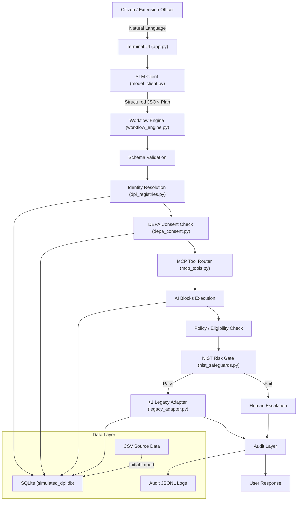

# Sovereign DPI-AI Public Agent — Implementation Plan

A local DPI-AI architectural prototype demonstrating Public Agents, AI Blocks, DPI Workflows, consent-based data access, NIST-inspired risk gates, human escalation, and "+1" legacy integration. Runs entirely on-device with Ollama (`qwen2.5-coder:7b`) and SQLite.

## User Review Required

> [!IMPORTANT]
> **Scenario Test Citizens** — Since `999-111` / "Ram Singh" does not exist in the dataset, the three demo scenarios will use real citizens discovered in the data:
> - **Scenario A (Success):** `765-741-434` — Suresh Kaur (ACTIVE identity, ACTIVE agri_land+credit consent, 12.8 acres land in Coimbatore)
> - **Scenario B (DEPA Failure):** `213-163-577` — Anjali Iyer (ACTIVE identity, consent allows agri_land only → credit request denied)
> - **Scenario C (Escalation):** `715-454-455` — Suresh Mishra (SUSPENDED identity → triggers escalation)

> [!IMPORTANT]
> **LLM Provider Abstraction** — You asked for plug-and-play switching between local and cloud LLMs. The `model_client.py` will define an abstract `LLMProvider` base class with `OllamaProvider` as default. A `CloudProvider` stub will be included so switching is a one-line config change.

> [!WARNING]
> **Ollama must be running** with `qwen2.5-coder:7b` pulled before the app can operate in SLM mode. Scenarios can also run in "offline/deterministic" mode without Ollama for testing.

## Open Questions

> [!IMPORTANT]
> **Minimum land area for subsidy eligibility** — The prompt says to make this configurable. I'll default to `2.0 acres` as the prototype policy threshold. Confirm or suggest a different value.

> [!NOTE]
> **Cryptographic signature verification** — The CSV signatures appear to be pre-computed SHA-256 hashes. The system will verify them by re-computing the hash from the record fields and comparing. This is labelled as simulated integrity verification.

---

## Data Analysis Summary

| Dataset | Records | Key Observations |
|---|---|---|
| `mosip_identity_registry.csv` | 10,000 | 8,513 ACTIVE, 1,487 SUSPENDED |
| `agriculture_land_registry.csv` | 10,000 | Land areas ~1–30 acres, various crops/districts |
| `mifos_credit_registry.csv` | 10,000 | Credit scores 300–900, various repayment statuses |
| `depa_consent_artefacts.csv` | 10,000 | 7,502 ACTIVE, 1,498 REVOKED, 1,000 EXPIRED |
| `legacy_municipal_log.csv` | 10,000 | Mix of COMPLETED and ESCALATED transactions |

**Granular permissions distribution:** `agri_land:read` (3,796), `mifos_credit:read` (4,971), `both` (1,233)

---

## Proposed Changes

### Phase 1 — Project Structure & Configuration

#### [NEW] `dpi_agent_project/config.py`
Central configuration with environment variable overrides. All constants (thresholds, paths, model settings) defined here with clear prototype labels.

#### [NEW] `dpi_agent_project/.env.example`
Template for environment variables: `OLLAMA_HOST`, `OLLAMA_MODEL`, `CONFIDENCE_THRESHOLD`, `DATABASE_PATH`, `AUDIT_DIRECTORY`, `LLM_PROVIDER`.

#### [NEW] `dpi_agent_project/requirements.txt`
Minimal dependencies: `requests` (for Ollama HTTP), plus stdlib. All others are stdlib.

#### [NEW] `dpi_agent_project/requirements_frozen.txt`
Pinned versions after venv creation.

---

### Phase 2 — CSV → SQLite Import

#### [NEW] `dpi_agent_project/dpi_registries.py`
- `initialize_database()` — Creates SQLite DB with 5 tables, parameterized DDL, indexes on `national_id`, `consent_id`, `land_record_id`, `transaction_id`
- `import_csv_datasets()` — Reads all 5 CSVs from `data_folder/`, bulk inserts into SQLite with parameterized SQL
- Idempotent: skips import if tables already populated
- Registry query functions:
  - `verify_identity(national_id)` → `{success, data: {national_id, full_name, preferred_language, identity_status}}` (phone masked)
  - `fetch_land_record(national_id)` → `{success, data: {land_record_id, survey_number, district, land_area_acres, current_crop}}`
  - `fetch_credit_profile(national_id)` → `{success, data: {credit_score, avg_monthly_turnover_inr, repayment_history_status, active_gst_billing_status}}`
  - `get_consent_records(national_id)` → `{success, data: [list of consent records]}`
  - `get_legacy_transactions(national_id)` → `{success, data: [list of transaction records]}`

---

### Phase 3 — DEPA Consent Engine

#### [NEW] `dpi_agent_project/depa_consent.py`
Five-gate consent validation:
1. **Status gate** — Only `ACTIVE` consents pass
2. **Expiry gate** — `valid_until` must be > current UTC time
3. **Granularity gate** — Requested data category (e.g., `mifos_credit:read`) must be in `granular_permissions`
4. **Purpose gate** — `consent_purpose` must align with workflow purpose
5. **Signature gate** — SHA-256 re-computation and comparison (labelled as simulated)

Every check writes to `audit/consent_audit_log.jsonl` with structured JSONL including `timestamp`, `consent_id`, `national_id`, `requested_data`, `purpose`, `result`, `reason`.

Key function: `validate_consent(national_id, required_permissions, workflow_purpose)` returns `{valid, consent_id, reason, details}`.

---

### Phase 4 — MCP-Style Tool Registry

#### [NEW] `dpi_agent_project/mcp_tools.py`
- Tool schema definitions for: `verify_identity`, `fetch_land_record`, `assess_credit_profile`, `check_consent`, `evaluate_subsidy_eligibility`, `create_legacy_transaction`, `risk_check`
- `TOOL_REGISTRY` dict mapping tool names → schemas + handler functions
- `execute_tool(tool_name, arguments)`:
  1. Validates tool name against allowlist
  2. Validates arguments against JSON schema (required params, types)
  3. Rejects unknown tools/params
  4. Routes to the correct AI Block function
  5. Returns structured JSON response
- No arbitrary code execution possible

---

### Phase 5 — LLM Client (Plug-and-Play)

#### [NEW] `dpi_agent_project/model_client.py`
- Abstract `LLMProvider` base class with `generate()`, `generate_json()`, `health_check()`
- `OllamaProvider` — HTTP calls to `http://localhost:11434/api/generate`
  - Structured JSON prompting with system prompt constraining output to the action schema
  - Temperature=0.1 for determinism
- `CloudProvider` (stub) — Placeholder for OpenAI/Anthropic API, raises NotImplementedError with instructions
- `DeterministicProvider` — For testing without Ollama; returns pre-built scenario responses
- Factory function `get_provider(provider_name)` reads from config
- SLM output contract enforced: only structured JSON with `intent`, `language`, `national_id`, `requested_action`, `required_tools`, `purpose`, `confidence`

---

### Phase 6 — NIST-Inspired Safeguards

#### [NEW] `dpi_agent_project/nist_safeguards.py`
Organized around NIST AI RMF functions (GOVERN, MAP, MEASURE, MANAGE):
- `evaluate_confidence(confidence, threshold)` — Application-specific 0.80 threshold, clearly documented as NOT a NIST mandate
- `check_ambiguity(model_output)` — Flags missing fields, contradictions
- `check_high_impact(workflow_type)` — Certain workflows (credit decisions) are high-impact
- `check_bias_risk(model_output)` — Prototype risk-indicator filter: unsupported claims, suspicious certainty, prohibited terms, missing evidence
- `apply_risk_gate(model_output, workflow_context)` — Composite gate returning `{pass, flags, decision, reason}`
- All checks are transparent, explainable, and labelled as "prototype risk-indicator filter"

---

### Phase 7 — Legacy Adapter (+1 Approach)

#### [NEW] `dpi_agent_project/legacy_adapter.py`
- `create_legacy_transaction(national_id, service_requested, consent_token_used, slm_confidence_score, execution_status)`:
  - Generates unique `TXN-` transaction ID
  - Writes to SQLite `legacy_municipal_log` table
  - Also appends to `data_folder/legacy_municipal_log_output.csv` (separate from original)
  - Never modifies original CSV
- Returns structured confirmation with transaction ID

---

### Phase 8 — Workflow Engine

#### [NEW] `dpi_agent_project/workflow_engine.py`
Main orchestration layer implementing the 13-step pipeline:

```
USER REQUEST → SLM INTERPRETATION → STRUCTURED PLAN → SCHEMA VALIDATION →
IDENTITY RESOLUTION → CONSENT CHECK → TOOL AUTHORIZATION → AI BLOCK EXECUTION →
POLICY/ELIGIBILITY CHECK → NIST RISK GATE → HUMAN ESCALATION OR APPROVAL →
+1 LEGACY WRITE-BACK → AUDIT → USER RESPONSE
```

Two pre-built workflows:
1. **`apply_for_solar_pump_subsidy`** — Full pipeline: identity → consent(agri_land) → land record → eligibility(min_land_area_acres configurable, default 2.0) → risk gate → legacy transaction
2. **`assess_agricultural_credit`** — Identity → consent(mifos_credit) → credit profile → cash-flow indicators → policy calculation → risk gate → human review if needed. Labelled as "prototype decision support", never a binding credit decision.

Key functions:
- `process_request(user_input)` — Entry point
- `execute_workflow(workflow_name, structured_plan)` — Deterministic execution
- `create_escalation(...)` — Writes to `audit/escalations_log.jsonl`
- All steps logged to `audit/workflow_audit_log.jsonl`

---

### Phase 9 — Terminal UI

#### [NEW] `dpi_agent_project/app.py`
Interactive terminal application:
```
1. Run Scenario A - Subsidy Success
2. Run Scenario B - DEPA Consent Failure
3. Run Scenario C - Human Escalation
4. Interactive Public Agent
5. Inspect Consent Audit
6. Inspect Workflow Audit
7. Inspect Escalations
8. Check Ollama
9. Exit
```

- Scenarios 1–3 use `DeterministicProvider` by default (no Ollama required) with option to use live SLM
- Option 4 uses live Ollama for interactive natural language queries
- Visible workflow step output: `[PUBLIC AGENT]`, `[DPI WORKFLOW]`, `[DEPA]`, `[AI BLOCK]`, `[POLICY]`, `[NIST-INSPIRED RISK GATE]`, `[+1 LEGACY ADAPTER]`, `[AUDIT]`
- Phone number masking in all output
- Multilingual: preserves `preferred_language` from identity, SLM can respond in that language

---

### Phase 10 — Tests

#### [NEW] `dpi_agent_project/tests/test_registries.py`
Tests: identity lookup, inactive/suspended identity, land lookup, credit lookup, missing records

#### [NEW] `dpi_agent_project/tests/test_consent.py`
Tests: valid consent, missing granular permission, expired consent, revoked consent, bad signature, purpose mismatch

#### [NEW] `dpi_agent_project/tests/test_tools.py`
Tests: tool allowlist enforcement, invalid tool rejection, malformed arguments, schema validation

#### [NEW] `dpi_agent_project/tests/test_safeguards.py`
Tests: confidence ≥ 0.80, confidence < 0.80, high-impact flagging, bias indicators, ambiguity detection

#### [NEW] `dpi_agent_project/tests/test_workflows.py`
Tests: subsidy success flow, subsidy rejection (no consent), credit workflow, escalation triggers

#### [NEW] `dpi_agent_project/tests/test_integration.py`
End-to-end tests for Scenario A, B, C using DeterministicProvider

---

### Phase 11 — Documentation

#### [NEW] `dpi_agent_project/README.md`
Professional README with:
- Project overview & disclaimer
- Architecture diagram (Mermaid)
- Data architecture
- AI Blocks catalog
- DPI Workflows
- DEPA consent flow
- NIST-inspired risk controls
- +1 Legacy Adapter
- Security boundaries
- Installation & setup (venv, pip, ollama pull)
- Running the application
- Known limitations

---

## Architecture Diagram



---

## Verification Plan

### Automated Tests
```bash
cd dpi_agent_project
python -m pytest tests/ -v
# or
python -m unittest discover -s tests -v
```

### Manual Verification
1. **Database initialization** — Verify `data_folder/simulated_dpi.db` is created with correct tables and row counts
2. **Ollama connectivity** — Menu option 8 verifies health check
3. **Scenario A** — Menu option 1: full subsidy success pipeline
4. **Scenario B** — Menu option 2: DEPA consent denial for credit data
5. **Scenario C** — Menu option 3: human escalation triggered
6. **Audit inspection** — Menu options 5–7: verify JSONL audit logs contain correct entries
7. **Interactive mode** — Menu option 4: free-form natural language queries (requires Ollama)

### Key Invariants to Verify
- Original CSV files are never modified
- SLM never executes SQL/Python/shell directly
- Rejected consent never exposes protected data
- All transactions create audit records
- Phone numbers are masked in output
- Confidence < 0.80 always triggers escalation
