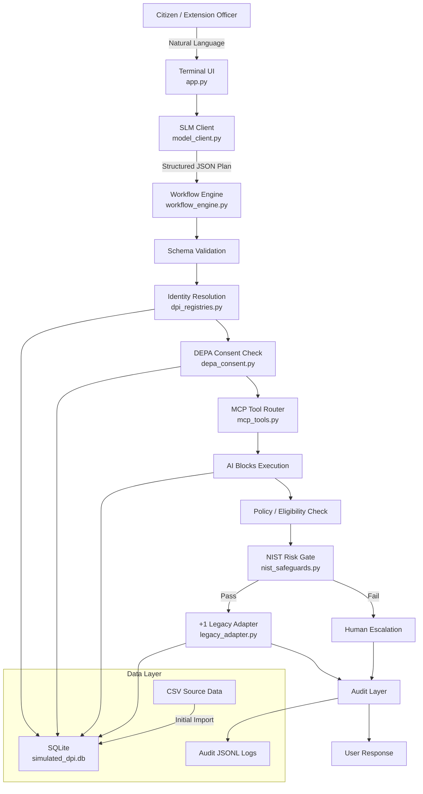

# Sovereign DPI-AI Public Agent

> **A local DPI-AI architectural prototype demonstrating Public Agents, AI Blocks,
> DPI Workflows, consent-based data access, NIST-inspired risk gates, human
> escalation, and "+1" legacy integration.**

> [!WARNING]
> This is a **LOCAL PROTOTYPE**, not a production government system. All runtime
> data and model inference remain entirely on the local device. It does not
> implement real government APIs, legal compliance frameworks, or production
> security hardening.

---

## Project Overview

The Sovereign DPI-AI Public Agent is a prototype system that demonstrates how
Digital Public Infrastructure (DPI) can be enhanced with AI capabilities while
maintaining:

- **Consent-based data access** (DEPA-inspired)
- **Deterministic policy enforcement**
- **NIST AI RMF-inspired risk gates**
- **Human oversight for high-impact decisions**
- **Auditability and transparency**
- **Interoperability through modular AI Blocks**

The system allows a citizen or extension officer to interact with a Small
Language Model (SLM) in natural language. The SLM proposes structured actions;
a deterministic workflow engine decides whether those actions are allowed.

### Source Materials

The conceptual design is informed by:

1. CDPI DPI-AI Framework 2026
2. AI x DPI Policy Brief 2026
3. India DEPA Framework
4. NIST AI RMF 1.0

---

## Architecture

```
                SLM (Ollama / qwen2.5-coder:7b)
                 |
                 | proposes structured JSON
                 v
          DETERMINISTIC WORKFLOW ENGINE
                 |
       +---------+---------+
       v         v         v
    CONSENT    POLICY     TOOL
      GATE       GATE      GATE
       |         |         |
       +---------+---------+
                 v
    +1 LEGACY ADAPTER --> AUDIT
                 v
              RESULT
```

**Key security boundary:** The SLM can only propose structured actions.
The deterministic workflow engine decides whether those actions are allowed.
The SLM never directly executes SQL, Python, shell commands, or filesystem
operations.

### Architecture Diagram



---

## Data Architecture

### Source Datasets (CSV - never modified at runtime)

| Registry | File | Records | Description |
|----------|------|---------|-------------|
| Identity | `mosip_identity_registry.csv` | 10,000 | MOSIP-style citizen records |
| Agriculture | `agriculture_land_registry.csv` | 10,000 | Land records with area/crop/district |
| Finance | `mifos_credit_registry.csv` | 10,000 | Credit scores and cash-flow data |
| Consent | `depa_consent_artefacts.csv` | 10,000 | DEPA consent records with granular permissions |
| Legacy | `legacy_municipal_log.csv` | 10,000 | Historical municipal transactions |

### SQLite Database

On first run, CSV datasets are imported into `data_folder/simulated_dpi.db`
with parameterized SQL and indexed for efficient querying. The runtime system
queries SQLite; original CSVs remain untouched.

### Audit Logs (JSONL)

| Log | File | Content |
|-----|------|---------|
| Consent | `audit/consent_audit_log.jsonl` | Every consent validation decision |
| Workflow | `audit/workflow_audit_log.jsonl` | Complete workflow execution records |
| Escalations | `audit/escalations_log.jsonl` | Human escalation cases |

---

## AI Blocks

Each bounded capability is implemented as an independently testable,
deterministic AI Block:

| AI Block | Description | Module |
|----------|-------------|--------|
| `verify_identity` | Verify citizen identity from MOSIP registry | `dpi_registries.py` |
| `fetch_land_record` | Retrieve agriculture land record | `dpi_registries.py` |
| `assess_credit_profile` | Fetch credit profile from Mifos registry | `dpi_registries.py` |
| `check_consent` | Validate DEPA consent for data access | `depa_consent.py` |
| `evaluate_subsidy_eligibility` | Deterministic eligibility check | `mcp_tools.py` |
| `create_legacy_transaction` | Write to +1 legacy system | `legacy_adapter.py` |
| `risk_check` | NIST-inspired risk assessment | `nist_safeguards.py` |

---

## DPI Workflows

### Solar Pump Subsidy (`apply_for_solar_pump_subsidy`)

```
Identity Verification -> DEPA Consent (agri_land) -> Land Record ->
Eligibility Check -> Risk Gate -> Legacy Transaction -> Audit
```

### Agricultural Credit (`assess_agricultural_credit`)

```
Identity Verification -> DEPA Consent (mifos_credit) -> Credit Profile ->
Cash-flow Analysis -> Policy Calculation -> Risk Gate -> Human Review -> Audit
```

**Note:** The credit workflow is labelled as **prototype decision support**
and must NOT be used for legally binding credit decisions.

---

## DEPA Consent Flow

Five-gate consent validation inspired by India's DEPA framework:

1. **Status Gate** - Only `ACTIVE` consents pass (reject `REVOKED`, `EXPIRED`)
2. **Expiry Gate** - `valid_until` must be > current UTC time
3. **Granularity Gate** - Requested data category must be in `granular_permissions`
4. **Purpose Gate** - `consent_purpose` must align with workflow purpose
5. **Signature Gate** - SHA-256 integrity verification (simulated)

> [!NOTE]
> The signature verification is a **simulated cryptographic integrity check**
> for prototype demonstration. It is not a production government
> credential-validation mechanism.

---

## NIST-Inspired Risk Controls

Risk assessment inspired by NIST AI RMF 1.0 functions (GOVERN, MAP, MEASURE, MANAGE):

| Check | Description |
|-------|-------------|
| Confidence | Application-specific threshold (default 0.80) |
| Ambiguity | Missing fields, contradictions, no tools |
| High-Impact | Enhanced scrutiny for credit/financial workflows |
| Bias Risk | Prohibited terms, suspicious certainty, unsupported claims |
| Policy | Workflow allowlist, tool authorization |

> [!IMPORTANT]
> The 0.80 confidence threshold is an **application-specific prototype policy**.
> It is **NOT** a threshold prescribed by NIST AI RMF.

---

## +1 Legacy Adapter

Demonstrates the CDPI "+1 approach":

- Does NOT modify or replace the original registry architecture
- Creates new transactions alongside existing data
- Writes to SQLite and a **separate** output CSV
- Never corrupts original input datasets

---

## Security Boundaries

- **Parameterized SQL** - No string interpolation in queries
- **Tool allowlist** - Only registered tools can be executed
- **Schema validation** - Arguments validated against JSON schemas
- **No arbitrary code execution** - SLM cannot execute Python/SQL/shell
- **Local model only** - No cloud LLM API calls (unless explicitly configured)
- **Consent-first** - Data access requires valid DEPA consent
- **Phone masking** - Phone numbers masked in all output
- **Audit logging** - Every decision is recorded
- **Input validation** - All inputs validated before processing

---

## Installation

### Prerequisites

- Python 3.11+
- [Ollama](https://ollama.ai/) (for live SLM mode)

### Setup

```bash
# Navigate to the project
cd dpi_agent_project

# Create virtual environment
python -m venv .venv

# Activate (Windows)
.venv\Scripts\activate

# Activate (macOS/Linux)
source .venv/bin/activate

# Install dependencies
pip install -r requirements.txt
```

### Pull the SLM model

```bash
ollama pull qwen2.5-coder:7b
```

### Configure (optional)

```bash
# Copy the example environment file
copy .env.example .env

# Edit as needed (all values have sensible defaults)
```

### Run Terminal Application

```bash
python app.py
```

### Run Local Web Interface

```bash
python server.py
```

Then open your browser at **`http://localhost:8000`** to access:
- **Interactive Public Agent Chat & Live Pipeline Visualizer**: Step-by-step visual animation across all 7 DPI stages.
- **Scenario Studio**: 1-click execution for Scenario A (Success), Scenario B (DEPA Failure), and Scenario C (Escalation).
- **Audit Intelligence Center**: Live searchable tables for Consent Audits, Workflow Traces, and Escalation Dossiers.
- **DPI Registries Explorer**: Browse and search 50,000+ SQLite simulated records across MOSIP, Agri, Credit, Consent, and Legacy.
- **Architecture & Governance Guide**: Interactive security boundary and governance principles overview.

---

## Running Tests

```bash
# Run all tests
python -m unittest discover -s tests -v

# Run specific test modules
python -m unittest tests.test_registries -v
python -m unittest tests.test_consent -v
python -m unittest tests.test_tools -v
python -m unittest tests.test_safeguards -v
python -m unittest tests.test_workflows -v
python -m unittest tests.test_integration -v
```

---

## LLM Provider Configuration

The system supports pluggable LLM providers via the `LLM_PROVIDER` setting:

| Provider | Setting | Description |
|----------|---------|-------------|
| Ollama | `LLM_PROVIDER=ollama` | Local SLM (default) |
| Cloud | `LLM_PROVIDER=cloud` | Stub for cloud APIs (not yet implemented) |
| Deterministic | `LLM_PROVIDER=deterministic` | Offline testing, no LLM required |

To switch providers, set `LLM_PROVIDER` in your `.env` file or environment.

---

## Demonstration Scenarios

### Scenario A - Subsidy Success

Citizen Suresh Kaur (ID 765-741-434) applies for a solar pump subsidy.
All gates pass: identity ACTIVE, consent ACTIVE with agri_land permission,
12.8 acres of land (above 2.0 acre minimum), confidence 0.91 > 0.80 threshold.
Transaction created successfully.

### Scenario B - DEPA Consent Failure

Citizen Anjali Iyer (ID 213-163-577) requests credit assessment.
Identity verified (ACTIVE), but consent only permits `agri_land:read`,
not `mifos_credit:read`. Credit data access is **DENIED**. No credit
information is returned or exposed.

### Scenario C - Human Escalation

Citizen Suresh Mishra (ID 715-454-455) has a SUSPENDED identity.
Identity verification fails, triggering automatic escalation to human review.
Escalation log created with full context for reviewer.

---

## Known Limitations

1. **Not a production system** - This is an architectural prototype for demonstration
2. **Simulated consent verification** - Signature checks are simulated, not production cryptography
3. **No real government APIs** - All data is local CSV/SQLite
4. **Limited SLM accuracy** - The 7B model may not perfectly parse all natural language inputs
5. **English-primary** - Multilingual support depends on model capabilities
6. **No authentication** - No user authentication mechanism
7. **Single-user** - Not designed for concurrent access
8. **Deterministic scenarios** - Demo scenarios use pre-built responses for reliability
9. **Policy thresholds are prototype values** - Not based on real government policy
10. **Bias detection is a prototype filter** - Not a comprehensive bias detector

---

## Project Structure

```
dpi_agent_project/
|
+-- app.py                  # Interactive terminal UI
+-- config.py               # Central configuration
+-- model_client.py         # Pluggable LLM client
+-- workflow_engine.py      # DPI Workflow orchestration
+-- dpi_registries.py       # DPI registry layer + CSV->SQLite
+-- depa_consent.py         # DEPA consent engine
+-- legacy_adapter.py       # +1 Legacy adapter
+-- nist_safeguards.py      # NIST-inspired risk gates
+-- mcp_tools.py            # MCP-style tool registry
|
+-- data_folder/
|   +-- mosip_identity_registry.csv
|   +-- agriculture_land_registry.csv
|   +-- mifos_credit_registry.csv
|   +-- depa_consent_artefacts.csv
|   +-- legacy_municipal_log.csv
|   +-- simulated_dpi.db          (created at runtime)
|
+-- audit/
|   +-- consent_audit_log.jsonl   (created at runtime)
|   +-- workflow_audit_log.jsonl  (created at runtime)
|   +-- escalations_log.jsonl     (created at runtime)
|
+-- tests/
|   +-- test_registries.py
|   +-- test_consent.py
|   +-- test_tools.py
|   +-- test_safeguards.py
|   +-- test_workflows.py
|   +-- test_integration.py
|
+-- requirements.txt
+-- requirements_frozen.txt
+-- .env.example
+-- README.md
```

---

## License

This prototype is provided for educational and demonstration purposes.
